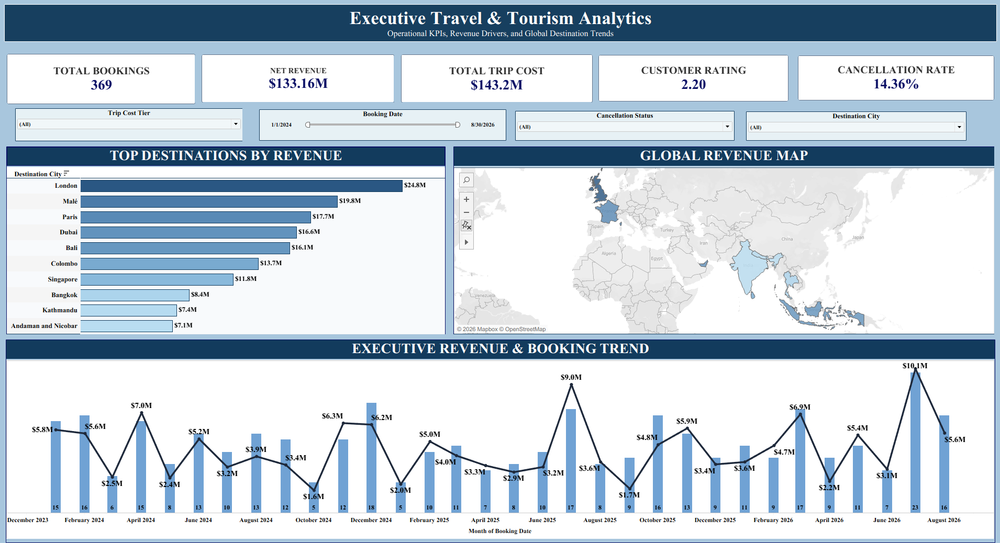
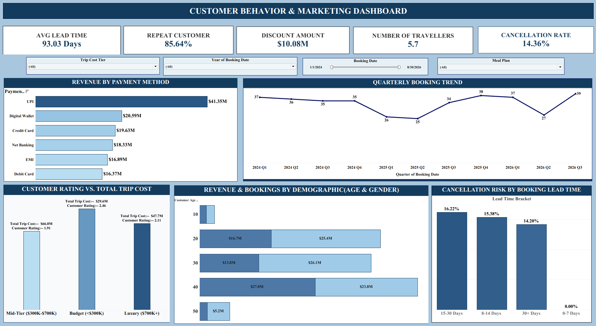

# Travel & Tourism Analytics Dashboard | Tableau

## Project Overview

The Travel & Tourism Analytics Dashboard is an interactive data visualization project developed using Tableau. It focuses on analyzing travel bookings, revenue trends, customer behavior, destination performance, and cancellation patterns to support data-driven business decisions.

The project consists of two dashboards that provide insights into business performance and customer booking behavior.

## Dashboards

### 1. Executive Travel & Tourism Analytics

**Key Features:**
- KPI cards for Total Bookings, Net Revenue, Total Trip Cost, Customer Rating, and Cancellation Rate.
- Top Destinations by Revenue.
- Global Revenue Map for destination analysis.
- Monthly Revenue and Booking Trend analysis.
- Interactive filters for Trip Cost Tier, Booking Date, Cancellation Status, and Destination City.

### 2. Customer Behavior & Marketing Dashboard

**Key Features:**
- Average Booking Lead Time and Repeat Customer Rate.
- Discount Amount and Number of Travellers.
- Revenue Analysis by Payment Method.
- Quarterly Booking Trend.
- Customer Rating and Trip Cost Analysis.
- Revenue and Booking Analysis by Age and Gender.
- Cancellation Patterns by Booking Lead Time.

## Tools & Technologies

- Tableau
- Data Visualization
- Business Intelligence
- KPI Analysis
- Interactive Dashboards

## Project Objectives

- Analyze booking and revenue performance.
- Identify popular destinations and payment preferences.
- Understand customer demographics and repeat booking patterns.
- Explore cancellation trends and booking lead times.
- Present business metrics through interactive visualizations.

## Key Learnings

- Dashboard design and layout management.
- KPI creation and presentation.
- Interactive filters and data exploration.
- Geographic data visualization.
- Business trend and customer behavior analysis.

## Project Files

- `Travel and Tourisum Analysis Dashboard.twb` — Tableau workbook.
- `Executive Travel & Tourism Analytics.png` — Executive dashboard screenshot.
- `Customer_Behavior Dashboard.png` — Customer behavior dashboard screenshot.

## Conclusion

This project demonstrates practical Tableau skills in business intelligence, data visualization, and analytical dashboard development. It provides an interactive way to explore travel business performance and customer trends.
